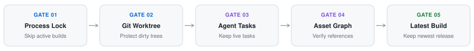

# Agent-Slim: Multi-Stack, Xcode & AI Workspace Deep Cleaner

[](./README.zh-CN.md)
[](https://github.com/Rem021/agent-slim/releases/tag/v2.1.0)
[](https://github.com/Rem021/agent-slim)
[](#1-five-stage-safety-pipeline)
[](./LICENSE)

> **Switch Language**: [**👉 点击切换至简体中文完整版 (`README.zh-CN.md`)**](./README.zh-CN.md)

**Agent-Slim** (`v2.1.0`) is a zero-dependency workspace cleaner and Xcode/macOS hygiene engine designed for developers running parallel AI coding agents and multi-language projects. It reclaims tens to hundreds of gigabytes of compiler intermediates, stale release archives, Xcode `DerivedData` / `CoreSimulator` / `DeviceSupport` caches, iterative VM `.cpio` rootfs images, and ghost `LaunchServices` (`🚫`) app registrations while strictly protecting uncommitted source code, active agent processes, and referenced project assets.

---

## 1. Five-Stage Safety Pipeline

Every directory and artifact is evaluated through five sequential safety gates before any cleanup action is allowed:

<p align="center">
  <picture>
    <source media="(prefers-color-scheme: dark)" srcset="./assets/safety-pipeline-en-dark.svg">
    <source media="(prefers-color-scheme: light)" srcset="./assets/safety-pipeline-en-light.svg">
    
  </picture>
</p>

| Gate | Protection Rule | Verification Method |
| :--- | :--- | :--- |
| **Gate 01** | Active Process & Age Lock | Inspects running process command lines (`ps -axo command`) and modification timestamps (`--min-age-hours`) to skip active builds, VMs, or tests. |
| **Gate 02** | Git Worktree Guard | Protects `.git`, `.svn`, `.hg`, `.jj`, uncommitted edits, staged changes, and tracked source files. |
| **Gate 03** | Agent Session & Docs Guard | Preserves agent rules/memories (`CLAUDE.md`, `AGENTS.md`, `.claude/`, `.codex/`, `.orca/`) and report documents while traversing `reports/`, `outputs/`, and `work/` to purge binary build caches. |
| **Gate 04** | Asset & Script Reference Graph | Parses `.fcpxml`, `.json` (`current.json`), `.py`, and `.sh` files so referenced media, `--source` baseline `.cpio` images, and active UUID installations are never removed. |
| **Gate 05** | Multi-Pattern Retention | Retains the newest `N` semantic releases, `current.json` UUID transactions, iterative VM `.cpio` builds, and test-run state backups while purging superseded historical dumps. |

---

## 2. Supported Stacks & Agent Workspaces

| Category | Supported Targets | Cleaned Artifacts | Protected State |
| :--- | :--- | :--- | :--- |
| **AI Coding Agents** | Claude Code, Codex, Cursor, Windsurf, Cline, Orca, Antigravity | Expired trace logs, detached build `.app` bundles, `*.saved-application`, superseded test-run `before/backup` state | Active conversations, rules (`CLAUDE.md`, `AGENTS.md`), skill definitions, JSON/Markdown test receipts |
| **Apple, Xcode & Mobile** | Xcode, SwiftPM, CoreSimulator, LaunchServices, Flutter, React Native | `DerivedData`, `Debug/Release-iphoneos/simulator`, `*UITests-Runner.app`, `CoreSimulator` caches/clones/`coresymbolicationd`, `DeviceSupport`, ghost `lsregister` (`🚫`) app icons | Source trees, `.xcodeproj`, signing profiles, `/Applications`, active Simulator user apps, latest release archive |
| **Systems, C++ & VM Labs** | Rust (`Cargo`), C/C++ (`CMake`), Go, Zig, QEMU/Kernel Labs | `target/`, `cmake-build-*`, object files (`.o`, `.dia`, `.pch`), superseded iterative `.cpio`/`.img`/`.fdat` rootfs builds | `Cargo.lock`, source headers, active QEMU/kernel process images, script-referenced `--source` baseline `.cpio` images |
| **Web, Python & Media** | Node (`pnpm`, `npm`, `bun`), Next.js, Vite, Python (`uv`, `pytest`), FCP | `.next`, `.turbo`, `__pycache__`, `.pytest_cache`, `wandb/`, FCP `Render Files` / `Transcoded Media`, SHA-256 duplicate scratch files | Lockfiles, `.env*`, AI model weights (`.safetensors`, `.gguf`, `.pt`, `.onnx`), FCPXML-referenced source media |

---

## 3. Quick Start

### Audit Mode (Read-Only Preview)

Run a full read-only scan across your workspace directory and Xcode system caches without deleting any files:

```bash
python3 scripts/agent_slim.py scan --root ~/Projects --clean-xcode --clean-launchservices
```

### Safe Cleanup Execution (Workspace + Xcode + LaunchServices)

Execute permanent cleanup after reviewing the audit report (enforces all 5 safety gates and unregisters ghost `.app` icons from macOS Launchpad):

```bash
python3 scripts/agent_slim.py clean --root ~/Projects --keep-latest-release 2 --clean-xcode --clean-device-support --clean-orphans --clean-launchservices --shield-spotlight
```

### JSON Report for Automation

Export a structured report for CI or scheduled maintenance scripts:

```bash
python3 scripts/agent_slim.py scan --root ~/Projects --json > report.json
```

---

## 4. Repository Layout

```text
agent-slim/
├── SKILL.md                  # Agent skill specification & invocation guide
├── scripts/
│   └── agent_slim.py         # Zero-dependency 5-gate scanner, cleaner & Xcode/LaunchServices optimizer
├── assets/                   # Theme-adaptive SVG diagrams (Dark & Light)
├── README.md                 # English documentation (default)
└── README.zh-CN.md           # Simplified Chinese documentation
```

---

## 5. Open-Source Rule Attributions & Credits

`agent-slim` integrates and extends orphan-detection and build-hygiene rules inspired by leading open-source projects:

- **[`alienator88/Pearcleaner`](https://github.com/alienator88/Pearcleaner)**: `~/Library` & `/Library` orphan scan locations and `LaunchAgents` target inspection.
- **[`tw93/Mole`](https://github.com/tw93/Mole)**: Bundle ID attribution over fuzzy name matching, macOS TCC / Sandbox (`containermanagerd`) boundary protection, and desktop `*-updater` staging cleanup.
- **[`momenbasel/PureMac`](https://github.com/momenbasel/PureMac)**, **[`slow-coding/fullcleaner`](https://github.com/slow-coding/fullcleaner)** & **[`Alyetama/Sweep`](https://github.com/Alyetama/Sweep)**: Multi-signal `LaunchServices` + `pkgutil` + Apple Developer `TeamID` cross-referencing for `Containers` and `Group Containers`.
- **[`jithin-sabu/purge-app`](https://github.com/jithin-sabu/purge-app)** & **Homebrew Cask `zap`**: Deterministic per-product `Application Support` verification.
- **[`tbillington/kondo`](https://github.com/tbillington/kondo)**, **[`voidcosmos/npkill`](https://github.com/voidcosmos/npkill)**, **[`mac-cleanup/mac-cleanup-py`](https://github.com/mac-cleanup/mac-cleanup-py)** & **[`brege/dil`](https://github.com/brege/dil)**: Anchor-file verification (`Cargo.toml`, `Package.swift`, `pom.xml`, `build.gradle`, `CMakeLists.txt`) and global package cache hygiene.

---

## 6. License

Released under the [MIT License](./LICENSE).
