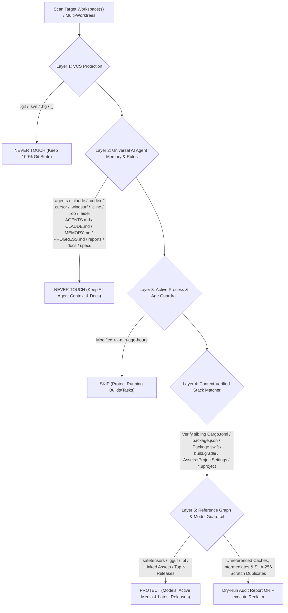

# `agent-slim` (v2.0.0)

**Universal AI Agent & Multi-Stack Workspace Deep Cleaner**  
**面向所有开发者与全栈 AI 编程智能体的通用工作区深度瘦身工具 & Agent Skill**

[](LICENSE)
[](https://www.python.org/)
[](#)
[](#)

---

## Why `agent-slim`? / 为什么需要 `agent-slim`？

When working with modern AI coding agents (**Claude Code, OpenAI Codex, Cursor, Windsurf, Cline, Roo Code, Aider, OpenHands, Devin, Orca, Antigravity**), agents routinely:
- Spawn multiple parallel **git worktrees** (`worktree-1`, `worktree-2`, ...) to explore features or run isolated bugfixes;
- Trigger full compiler toolchains (`Cargo target/`, `Xcode DerivedData/`, `Next.js .next/`, `Gradle .gradle/`, `Unity Library/`, `CMakeFiles/`);
- Dump intermediate test artifacts, crash dumps (`.core`, `.dmp`, `.xcresult`, `.trace`), W&B/Lightning experiment logs, and temporary scratch copies.

Within days, a few 500 MB repositories can silently balloon into **200 GB – 1 TB+** of redundant disk usage. Traditional cleaners either miss multi-worktree agent caches or recklessly delete files that break your project or erase your AI agent's memory.

`agent-slim` solves this for **any developer and any tech stack**:
1. **7 Universal Tech Ecosystems Supported Out-of-the-Box** (Web/JS/TS, Python/AI/ML, Rust/C++/Go/Zig, iOS/macOS/Android/Flutter, Unity/Unreal/Godot, Terraform/Cloud, Media/Graphics).
2. **5-Layer Safety Guardrails** that strictly protect Git history, uncommitted work, AI Agent memory/rules (`AGENTS.md`, `CLAUDE.md`, `.cursor/`, `.claude/`, `.codex/`, `MEMORY.md`, `PROGRESS.md`), AI model weights (`.safetensors`, `.gguf`, `.pt`), and sibling-verified project directories.
3. **Dual-Mode Usage**: Works both as a **standalone CLI (`agent-slim`)** and as an **installable AI Agent Skill (`SKILL.md`)** that any agent can invoke autonomously.

---

## Architecture & 5-Layer Safety Guardrails / 五层安全护栏架构



### What is ALWAYS Protected (Never Deleted)? / 永远受保护的内容

| Protection Layer | Protected Targets |
| :--- | :--- |
| **1. Version Control & Code** | `.git/`, `.svn/`, `.hg/`, `.jj/`, all source code, uncommitted modifications, and all lockfiles (`package-lock.json`, `pnpm-lock.yaml`, `yarn.lock`, `bun.lockb`, `Cargo.lock`, `uv.lock`, `poetry.lock`, `Podfile.lock`, `Package.resolved`) |
| **2. AI Agent Memory & Rules** | `.agents/`, `.claude/`, `.codex/`, `.gemini/`, `.cursor/`, `.windsurf/`, `.cline/`, `.roo/`, `.continue/`, `.aider/`, `.openhands/`, `.devin/`, `.orca/`, `.antigravity/`, `AGENTS.md`, `CLAUDE.md`, `GEMINI.md`, `CURSOR.md`, `MEMORY.md`, `PROGRESS.md`, `HANDOFF.md`, `PLAN.md`, `RULES.md`, `.cursorrules`, `.windsurfrules`, `.clinerules`, `.roorules` |
| **3. Docs, Specs & Test Truth** | `docs/`, `reports/`, `research_notes/`, `specs/`, `adr/`, `memory/`, `prompts/`, `skills/`, `fixtures/`, `testdata/`, `__snapshots__/`, `migrations/` |
| **4. AI Model Weights** | `.safetensors`, `.gguf`, `.ckpt`, `.onnx`, `.pt`, `.pth`, `.bin`, `.h5`, `.tflite`, `.mlmodel` |
| **5. Active Releases & Media** | Top `N` newest versioned release builds (`--keep-versions 2`) + any asset actively referenced in project manifests (`.fcpxml`, JSON pointers) |

---

## Supported Tech Stacks (7 Ecosystems) / 支持的七大技术栈生态

| Ecosystem | Cleaned Caches & Build Artifacts | Context Verification Rule |
| :--- | :--- | :--- |
| **1. Web / Frontend / Full-Stack** | `.next`, `.nuxt`, `.output`, `.svelte-kit`, `.astro`, `.turbo`, `.parcel-cache`, `.vite`, `.angular`, `.docusaurus`, `.vercel`, `.netlify`, `.wrangler`, `storybook-static`, `playwright-report`, `test-results`, `.nyc_output`, `.eslintcache`, `node_modules` *(opt-in)* | `node_modules/` requires `--include-node-modules` + sibling `package.json` |
| **2. Python / AI / ML / Data** | `__pycache__`, `.pytest_cache`, `.mypy_cache`, `.ruff_cache`, `.pytype`, `.hypothesis`, `.tox`, `.nox`, `.ipynb_checkpoints`, `.gradio`, `lightning_logs`, `multirun` (Hydra), `wandb/` local run caches, `.pyc`/`.pyo` | `wandb/` verified by `run-*` / `offline-run-*` structure; model weights (`.safetensors`, `.gguf`, `.pt`) strictly protected |
| **3. Systems (Rust / C / C++ / Go / Zig)** | Cargo `target/`, Maven `target/`, `CMakeFiles`, `cmake-build-*`, `bazel-*`, `.zig-cache`, `zig-out`, `ccache`/`sccache`, `.o`, `.obj`, `.lo`, `.dia`, `.pch`, `.gch`, `.core`/`.dmp` crash dumps, `.profraw`/`.profdata` | `target/` requires sibling `Cargo.toml` or `pom.xml`; `build/` requires `CMakeCache.txt` or `build.ninja` |
| **4. Mobile & Desktop Native** | Xcode `DerivedData`, SwiftPM `.build`, `ModuleCache.noindex`, `Index.noindex`, `.xcresult`, `.dSYM`, `.trace`, Android `.gradle`, `.kotlin`, `.cxx`, Gradle/Flutter `build/`, `.dart_tool`, React Native `.expo`, unavailable iOS Simulators | `.build/` requires sibling `Package.swift` or Xcode project; `build/` requires `build.gradle(.kts)` or `pubspec.yaml` |
| **5. Game Engines (Unity / Unreal / Godot)** | **Unity**: `Library/`, `Temp/`, `Obj/`, `Logs/`<br>**Unreal**: `Intermediate/`, `DerivedDataCache/`, `Saved/Logs`, `Saved/Crashes`<br>**Godot**: `.godot/` | Unity requires sibling `Assets/` + `ProjectSettings/`; Unreal requires sibling `*.uproject` |
| **6. DevOps / Cloud / IaC** | Terraform `.terraform`, `.terragrunt-cache`, Serverless `.serverless`, AWS SAM `.aws-sam` | Exact provider/build cache directories |
| **7. Media / Creative / Graphics** | Final Cut Pro `.fcpbundle` (`Render Files`, `Transcoded Media`, `Analysis Files`), Blender `.blend1`/`.blend2`, raw GPU framebuffer dumps (`.rgba16f`, `.rgba32f`, debug `.raw`), SHA-256 duplicate scratch files | `.fcpxml` reference graph parsed so active external clips are never touched |

---

## Quick Start / 快速安装与使用

### 1. One-Line Install (CLI + Universal Agent Skill) / 一键安装

```bash
git clone https://github.com/Rem021/agent-slim.git
cd agent-slim
./install.sh
```

`./install.sh` automatically:
- Installs the `agent-slim` CLI into `~/.local/bin/agent-slim`
- Registers the `agent-slim` Skill across your installed AI coding agents (`~/.agents/skills`, `~/.claude/skills`, `~/.codex/skills`, `~/.cursor/skills`, etc.)

### 2. CLI Usage Examples / 命令行使用示例

#### Step 1 — Dry-Run Audit (Default, 100% Safe, Deletes Nothing) / 默认安全预演扫描
```bash
agent-slim ~/Projects /Volumes/WorkDrive/AI-Worktrees
```

#### Step 2 — Execute Cleanup / 执行正式清理
```bash
agent-slim ~/Projects /Volumes/WorkDrive/AI-Worktrees --execute
```

#### Step 3 — Full Multi-Worktree Sweep (Include `node_modules`, Protect Active Builds < 2h, Export JSON Audit)
```bash
agent-slim ~/Projects \
  --include-node-modules \
  --min-age-hours 2 \
  --keep-versions 2 \
  --dedup-scratch-mb 25 \
  --clean-simulators \
  --report-json ./slim-audit.json \
  --execute
```

### 3. Using as an AI Agent Skill / 在 AI Agent 中直接对话调用

Once installed, simply tell **Claude Code, Codex, Cursor, Windsurf, Cline, or Antigravity**:
> *"Use `agent-slim` to audit and clean up my project worktrees without touching my progress or agent memory."*  
> *“使用 `agent-slim` 深度清理我项目里的构建缓存和冗余文件，保留开发进度和 Agent 记忆。”*

---

## CLI Options Reference / 命令行参数一览

| Argument / Flag | Default | Description / 说明 |
| :--- | :--- | :--- |
| `paths...` | *(Required)* | One or more project, worktree, or workspace root directories to scan / 要扫描的一个或多个项目或工作区目录 |
| `--execute` | `False` | Perform actual deletion (omit for safe Dry-Run preview) / 执行实际删除（不加则为安全预演模式） |
| `--include-node-modules` | `False` | Also clean reinstallable `node_modules/` (verified by sibling `package.json`) / 同时清理可重装的 `node_modules/` |
| `--keep-versions N` | `2` | Retain top `N` newest versioned release builds per prefix group / 每个版本组保留最新的 `N` 个发布包 |
| `--min-age-hours H` | `0.0` | Skip caches/artifacts modified within the last `H` hours (protects active builds) / 跳过最近 `H` 小时内修改过的目录以保护正在运行的任务 |
| `--dedup-scratch-mb MB` | `25.0` | Fast SHA-256 deduplication of identical large files (`>= MB`) in scratch/temp folders / 对临时目录中大于 `MB` 的重复大文件进行 SHA-256 去重 |
| `--clean-simulators` | `False` | Run `xcrun simctl delete unavailable` on macOS / 清理 macOS 上失效的旧版 iOS 模拟器运行时 |
| `--report-json PATH` | `None` | Write a full machine-readable JSON audit report to `PATH` / 导出完整的 JSON 审计报告 |

---

## License

MIT License — Free for personal and commercial use.
