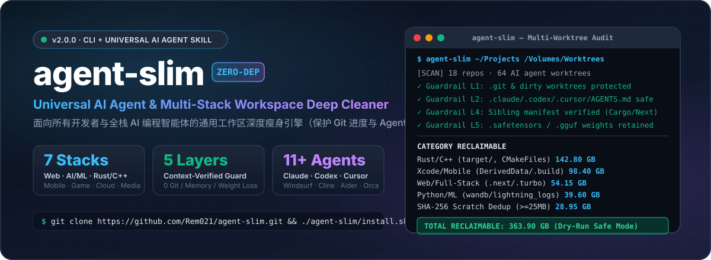
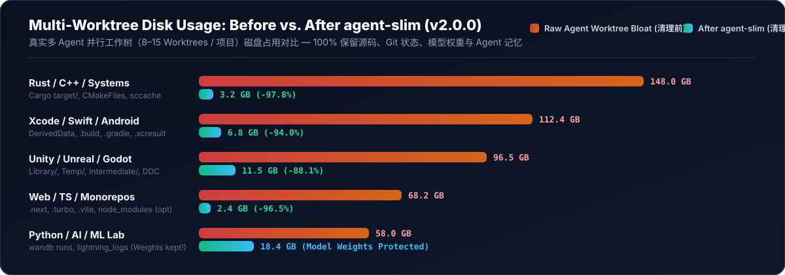
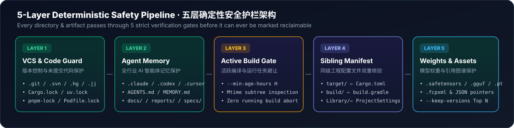
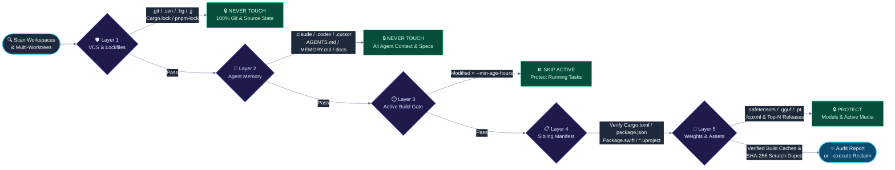

<div align="center">



<br/>

[](https://github.com/Rem021/agent-slim/releases/tag/v2.0.0)
[](https://www.python.org/)
[](#)
[](#-supported-tech-ecosystems-7-stacks--支持的七大技术栈生态)
[](#-using-as-an-ai-agent-skill--作为-ai-agent-技能调用)
[](LICENSE)

<p align="center">
  <a href="#-why-agent-slim--为什么需要-agent-slim"><b>Why agent-slim?</b></a> ·
  <a href="#-quick-start--30秒快速上手"><b>Quick Start</b></a> ·
  <a href="#-5-layer-safety-guardrails--五层确定性安全护栏"><b>5-Layer Guardrails</b></a> ·
  <a href="#-supported-tech-ecosystems-7-stacks--支持的七大技术栈生态"><b>7 Tech Stacks</b></a> ·
  <a href="#-cli-options-reference--命令行参数字典"><b>CLI Reference</b></a> ·
  <a href="#-中文核心指南-chinese-overview"><b>🇨🇳 中文指南</b></a>
</p>

</div>

---

## ⚡ Why `agent-slim`? / 为什么需要 `agent-slim`？

Modern AI coding agents (**Claude Code, OpenAI Codex, Cursor, Windsurf, Cline, Roo Code, Aider, OpenHands, Devin, Orca, Antigravity**) accelerate engineering by spawning **parallel Git worktrees** (`worktree-1`, `worktree-2`, …) and running full compiler toolchains in each isolated checkout.

Within days, a few 500 MB repositories silently balloon into **200 GB – 1 TB+** of redundant build caches (`Cargo target/`, `Xcode DerivedData/`, `Next.js .next/`, `Gradle .gradle/`, `Unity Library/`, `CMakeFiles/`, `wandb/` runs, `.xcresult` bundles, and duplicate scratch dumps). Traditional system cleaners either miss multi-worktree agent caches or recklessly delete files that break your project or erase your AI agent's memory.

<div align="center">
  
</div>

> [!TIP]
> **Built for Zero-Risk Autonomy**: `agent-slim` defaults to **100% read-only Dry-Run mode**. Even when `--execute` is passed, every candidate directory is verified against its sibling project manifest (`Cargo.toml`, `package.json`, `Package.swift`, `build.gradle`, `Assets/ + ProjectSettings/`, `*.uproject`) before a single byte is removed.

---

## 🛡️ 5-Layer Safety Guardrails / 五层确定性安全护栏

<div align="center">
  
</div>



### What is **ALWAYS Protected** (Never Deleted)? / 永远受保护的核心资产

| Guardrail Layer | Protected Files & Directories | Why It Matters |
| :--- | :--- | :--- |
| **1. VCS & Source Code** | `.git/`, `.svn/`, `.hg/`, `.jj/`, all tracked/untracked source code, uncommitted changes, stashes, and lockfiles (`package-lock.json`, `pnpm-lock.yaml`, `yarn.lock`, `bun.lockb`, `Cargo.lock`, `uv.lock`, `poetry.lock`, `Podfile.lock`, `Package.resolved`) | Guarantees zero Git history corruption, zero lost worktrees, and deterministic dependency resolution. |
| **2. AI Agent Memory & Rules** | `.agents/`, `.claude/`, `.codex/`, `.gemini/`, `.cursor/`, `.windsurf/`, `.cline/`, `.roo/`, `.continue/`, `.aider/`, `.openhands/`, `.devin/`, `.orca/`, `.antigravity/`, `AGENTS.md`, `CLAUDE.md`, `GEMINI.md`, `CURSOR.md`, `MEMORY.md`, `PROGRESS.md`, `HANDOFF.md`, `PLAN.md`, `RULES.md`, `.cursorrules`, `.windsurfrules`, `.clinerules`, `.roorules` | Preserves 100% of your AI coding agents' instructions, long-term memory, session skills, and task handoffs. |
| **3. Docs, Specs & Test Truth** | `docs/`, `reports/`, `research_notes/`, `specs/`, `adr/`, `memory/`, `prompts/`, `skills/`, `fixtures/`, `testdata/`, `__snapshots__/`, `migrations/` | Never touches architectural decision records, test fixtures, database migrations, or engineering reports. |
| **4. AI Model Weights** | `.safetensors`, `.gguf`, `.ckpt`, `.onnx`, `.pt`, `.pth`, `.bin`, `.h5`, `.tflite`, `.mlmodel` | Cleans training run logs (`wandb/`, `lightning_logs/`) while strictly protecting expensive local LLM/ML checkpoints. |
| **5. Active Releases & Media** | Top `N` newest versioned release builds (`--keep-versions 2`) + any media asset referenced in project manifests (`.fcpxml`, JSON pointers) | Retains your latest deliverable builds and active video/audio timeline assets while purging stale renders. |

---

## 🌐 Supported Tech Ecosystems (7 Stacks) / 支持的七大技术栈生态

`agent-slim` uses **Sibling Manifest Context Verification** (`classify_context_verified_dir`) so generic folder names like `target/`, `build/`, or `Library/` are **only** cleaned when their parent directory proves they belong to a specific build tool:

| # | Ecosystem | Reclaimed Caches & Intermediates | Context Verification Rule |
| :-: | :--- | :--- | :--- |
| **01** | **Web / Frontend / Full-Stack**<br>*(Next.js, Nuxt, Vite, Turbo, Astro)* | `.next`, `.nuxt`, `.output`, `.svelte-kit`, `.astro`, `.turbo`, `.parcel-cache`, `.vite`, `.angular`, `.docusaurus`, `.vercel`, `.netlify`, `.wrangler`, `storybook-static`, `playwright-report`, `test-results`, `.nyc_output`, `.eslintcache`, `node_modules` *(opt-in)* | `node_modules/` requires explicit `--include-node-modules` **and** sibling `package.json` |
| **02** | **Python / AI / ML / Data**<br>*(PyTorch, W&B, Hydra, Jupyter)* | `__pycache__`, `.pytest_cache`, `.mypy_cache`, `.ruff_cache`, `.pytype`, `.hypothesis`, `.tox`, `.nox`, `.ipynb_checkpoints`, `.gradio`, `lightning_logs`, `multirun`, `wandb/` local run caches, `.pyc`/`.pyo` | `wandb/` verified by internal `run-*` / `offline-run-*` structure; model weights strictly excluded |
| **03** | **Systems Engineering**<br>*(Rust, C, C++, Go, Zig, Java)* | Cargo `target/`, Maven `target/`, `CMakeFiles`, `cmake-build-*`, `bazel-*`, `.zig-cache`, `zig-out`, `ccache`/`sccache`, `.o`, `.obj`, `.lo`, `.dia`, `.pch`, `.gch`, `.core`/`.dmp` crash dumps, `.profraw`/`.profdata` | `target/` requires sibling `Cargo.toml` or `pom.xml`; `build/` requires `CMakeCache.txt` or `build.ninja` |
| **04** | **Mobile & Desktop Native**<br>*(Xcode, SwiftPM, Android, Flutter)* | Xcode `DerivedData`, SwiftPM `.build`, `ModuleCache.noindex`, `Index.noindex`, `.xcresult`, `.dSYM`, `.trace`, Android `.gradle`, `.kotlin`, `.cxx`, Gradle/Flutter `build/`, `.dart_tool`, `.expo`, unavailable iOS Simulators | `.build/` requires sibling `Package.swift` or `*.xcodeproj`; `build/` requires `build.gradle(.kts)` or `pubspec.yaml` |
| **05** | **Game Engines**<br>*(Unity, Unreal Engine, Godot)* | **Unity**: `Library/`, `Temp/`, `Obj/`, `Logs/`<br>**Unreal**: `Intermediate/`, `DerivedDataCache/`, `Saved/Logs`, `Saved/Crashes`<br>**Godot**: `.godot/` | Unity requires sibling `Assets/` **+** `ProjectSettings/`; Unreal requires sibling `*.uproject` |
| **06** | **DevOps / Cloud / IaC**<br>*(Terraform, Terragrunt, SAM)* | Terraform `.terraform`, `.terragrunt-cache`, Serverless `.serverless`, AWS SAM `.aws-sam` | Exact provider & synthesis cache directory matching |
| **07** | **Media / Creative / GPU**<br>*(Final Cut Pro, Blender, Shaders)* | Final Cut Pro `.fcpbundle` (`Render Files`, `Transcoded Media`, `Analysis Files`), Blender `.blend1`/`.blend2`, raw GPU framebuffer dumps (`.rgba16f`, `.rgba32f`, debug `.raw`), SHA-256 duplicate scratch files | Parses `.fcpxml` reference graphs so active external media clips are never deleted |

---

## 🚀 Quick Start / 30秒快速上手

### 1. One-Line Install (CLI + Universal Agent Skill) / 一键安装

```bash
git clone https://github.com/Rem021/agent-slim.git && cd agent-slim && ./install.sh
```

Running `./install.sh` automatically:
1. Installs the zero-dependency `agent-slim` executable into `~/.local/bin/agent-slim`;
2. Registers the `agent-slim` Skill (`SKILL.md` + `scripts/agent_slim.py`) across all detected AI coding agents (`~/.agents/skills`, `~/.claude/skills`, `~/.codex/skills`, `~/.cursor/skills`, etc.).

### 2. CLI Workflow / 命令行三步工作流

#### ① Dry-Run Audit (Default — 100% Read-Only, Deletes Nothing)
```bash
agent-slim ~/Projects /Volumes/WorkDrive/AI-Worktrees
```

#### ② Execute Safe Cleanup (Reclaim Verified Caches)
```bash
agent-slim ~/Projects /Volumes/WorkDrive/AI-Worktrees --execute
```

#### ③ Deep Multi-Worktree Sweep (With `node_modules`, Active-Build Shield & JSON Audit Receipt)
```bash
agent-slim ~/Projects /Volumes/WorkDrive/AI-Worktrees \
  --include-node-modules \
  --min-age-hours 2 \
  --keep-versions 2 \
  --dedup-scratch-mb 25 \
  --clean-simulators \
  --report-json ./slim-audit.json \
  --execute
```

---

## 🤖 Using as an AI Agent Skill / 作为 AI Agent 技能调用

Once installed, any compatible agent (**Claude Code, OpenAI Codex, Cursor, Windsurf, Cline, Roo Code, Aider, Orca, Antigravity**) automatically discovers `agent-slim`. Simply ask your agent in natural language:

> 💬 **English Prompt**:  
> *"Use `agent-slim` to audit and clean up my project worktrees. Protect any build modified in the last 2 hours and show me the space reclaimed by category."*

> 💬 **中文提示词**:  
> *“使用 `agent-slim` 深度清理我项目和各个工作树里的编译缓存与冗余文件，保留最近 2 小时内的活跃构建、所有开发进度和 Agent 记忆，并按类别汇报释放的空间。”*

---

## ⚙️ CLI Options Reference / 命令行参数字典

| Argument / Flag | Default | Description / 详细说明 |
| :--- | :---: | :--- |
| `paths...` | *(Required)* | One or more project, worktree, or workspace root directories to scan / 要扫描的一个或多个项目或工作区根目录 |
| `--execute` | `False` | Perform actual deletion (omit for 100% read-only Dry-Run preview) / 执行实际清理（不加则为只读安全预览模式） |
| `--include-node-modules` | `False` | Also clean reinstallable `node_modules/` (verified by sibling `package.json`) / 同时清理可重装的 `node_modules/` |
| `--keep-versions N` | `2` | Retain top `N` newest versioned release builds per prefix group / 每个发布前缀组保留最新的 `N` 个版本包 |
| `--min-age-hours H` | `0.0` | Skip caches/artifacts modified within the last `H` hours (protects active builds) / 跳过最近 `H` 小时内修改过的目录以保护后台编译任务 |
| `--dedup-scratch-mb MB` | `25.0` | Fast SHA-256 deduplication of identical large files (`>= MB`) in scratch/temp folders / 对临时目录中大于 `MB` 的重复大文件进行 SHA-256 去重 |
| `--clean-simulators` | `False` | Run `xcrun simctl delete unavailable` on macOS to purge orphaned runtimes / 清理 macOS 上失效的旧版 iOS 模拟器运行时 |
| `--report-json PATH` | `None` | Write a full machine-readable JSON audit receipt to `PATH` / 导出完整的结构化 JSON 审计回执 |

---

## 🇨🇳 中文核心指南 (Chinese Overview)

<details open>
<summary><b>点击展开 / 收起：核心设计哲学与安全承诺</b></summary>

<br/>

在使用 **Claude Code、Codex、Cursor、Windsurf、Orca、Antigravity** 等多智能体并行开发时，AI 往往会创建数十个并发 Git Worktree 并触发全量编译（如 Rust `target/`、Xcode `DerivedData/`、前端 `.next/`、Unity `Library/`、机器学习 `wandb/` 缓存），短短几天就会吞噬数百 GB 的 SSD 空间。

**`agent-slim` v2.0.0 的三大核心优势**：
1. **真正的零配置跨技术栈通用性**：不再依赖死板的路径硬编码，而是通过**同级工程清单双重校验（Sibling Manifest Verification）**自动识别 7 大主流技术栈（Web、Python/AI、Rust/C++/系统、iOS/Android/移动端、Unity/Unreal/游戏引擎、云原生 IaC、音视频后期与图形学）。
2. **五层确定性护栏（绝不误删进度与记忆）**：
   - **绝不触碰版本控制与源码**：100% 保护 `.git`、未提交代码、Lockfile；
   - **绝不触碰 AI 记忆与规范**：100% 保护 `.claude/`、`.codex/`、`.cursor/`、`AGENTS.md`、`CLAUDE.md`、`MEMORY.md`、`PROGRESS.md`、`docs/`、`reports/`；
   - **绝不误伤本地大模型权重**：`.safetensors`、`.gguf`、`.pt`、`.ckpt`、`.onnx` 默认列入最高级别白名单；
   - **支持活跃任务避让（`--min-age-hours`）**：正在后台编译或运行的任务自动跳过。
3. **双栖形态（CLI + Agent Skill）**：既可以在终端一键运行，也可以直接用自然语言指挥任何 AI 编程助手自动完成盘点与瘦身。

</details>

---

## 📄 License

Released under the [MIT License](LICENSE) — Free for personal, academic, and commercial use.
